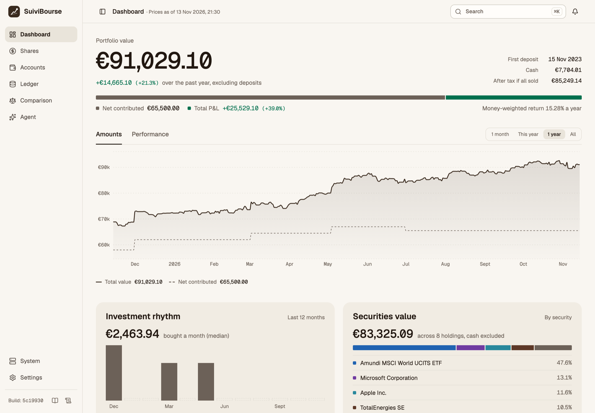

<p align="center">
  <picture>
    <source media="(prefers-color-scheme: dark)" srcset="website/static/img/brand/logo-dark.png">
    
  </picture>
</p>

<p align="center">Track your portfolio: your events in, your figures out, in one container.</p>

<p align="center">
  <a href="https://github.com/pbrissaud/suivi-bourse/releases/latest"></a>
  <a href="LICENSE"></a>
  <a href="https://hub.docker.com/r/paulbrissaud/suivi-bourse"></a>
</p>

<picture>
  <source media="(prefers-color-scheme: dark)" srcset="website/static/img/app-dashboard-dark.png">
  
</picture>

SuiviBourse is a self-hosted tracker for your stock portfolio. You record what
you buy, sell, receive and pay in. It fetches the prices, values your positions
and computes your returns.

## What it does

- **A ledger of events**: buys, sells, free shares, dividends, cash in and cash
  out. Record them one by one, or import a `.csv` or `.xlsx` file.
- **Prices fetched for you**: current prices, and the price history back to your
  first purchase, rebuilt whenever the ledger changes.
- **One base currency**: every figure is converted into the currency you choose.
- **Returns**: a time-weighted performance curve and a money-weighted return
  (XIRR).
- **Tax per account**: give each account a tax model and see your gain after
  tax if you sold everything.
- **Comparison**: replay the money you put in securities into an index fund of
  your choice.
- **An optional agent**: ask questions about your portfolio with your own
  provider key (Anthropic, OpenAI, an OpenAI-compatible endpoint or Ollama). An
  MCP server lets your own agent read the portfolio too.

## Quick start

```bash
docker run -d \
  --name suivi-bourse \
  --restart unless-stopped \
  -v suivi-bourse:/data \
  -p 8080:8080 \
  ghcr.io/pbrissaud/suivi-bourse:5
```

Open [http://localhost:8080](http://localhost:8080) and answer the first
questions. [Install with Docker](https://pbrissaud.github.io/suivi-bourse/docs/v5/get-started)
covers Compose, updates and health checks.

> [!WARNING]
> A new installation has no access code. Anyone who can reach port 8080 can read
> and change your portfolio. Set a code in **Settings → Security**, or keep the
> app on a private network. See
> [Secure access](https://pbrissaud.github.io/suivi-bourse/docs/v5/secure-access)
> and [SECURITY.md](SECURITY.md).

## Documentation

The documentation is in [English](https://pbrissaud.github.io/suivi-bourse/docs/v5/)
and [French](https://pbrissaud.github.io/suivi-bourse/fr/docs/v5/).

- [Using SuiviBourse](https://pbrissaud.github.io/suivi-bourse/docs/v5/first-steps):
  the first launch, the pages, import, the agent.
- [Installation and administration](https://pbrissaud.github.io/suivi-bourse/docs/v5/get-started):
  Docker, configuration, access code, backups.

## Contributing

Bug reports and pull requests are welcome. Read [CONTRIBUTING.md](CONTRIBUTING.md)
first. Report a vulnerability privately, as [SECURITY.md](SECURITY.md) describes.

## Licence

[MIT](LICENSE)
